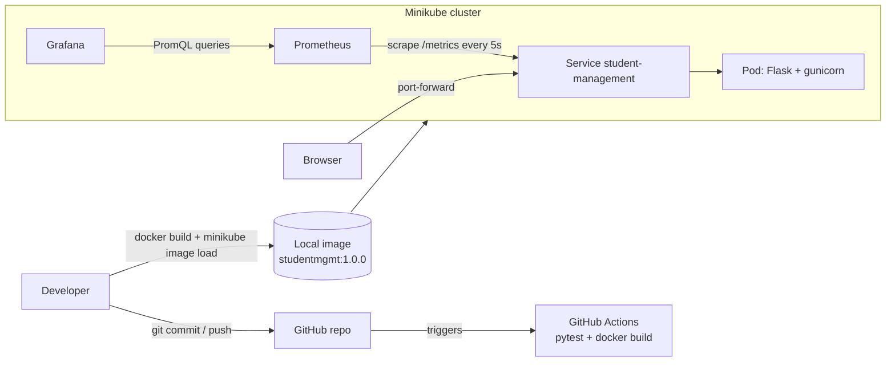

# End-to-End DevOps Pipeline for a Student Management System

Git · GitHub Actions · Docker · Kubernetes (Minikube) · Prometheus · Grafana

One small Flask application is taken through the whole DevOps lifecycle: code → version control → automated tests → container image → Kubernetes deployment → metrics → dashboard.

## Problem statement

Manually testing, packaging, deploying and watching an application is slow and error-prone. This project shows how DevOps tooling automates and observes each stage, using a deliberately small Student Management System as the subject.

## Objectives

1. Build a working web application with a JSON API, validation, health and metrics endpoints.
2. Track it with Git and host it on GitHub.
3. Run automated tests and a Docker build on every push/PR with GitHub Actions.
4. Package it as a non-root Docker image.
5. Deploy it on Kubernetes (Minikube) with probes, resource limits, rolling update and rollback.
6. Collect application metrics with Prometheus and visualise them in Grafana.

## Architecture



| Step | Automated? |
|---|---|
| Tests + Docker build on push/PR | **Automated** (GitHub Actions) |
| Loading the image into Minikube and `kubectl apply` | **Manual** (a hosted GitHub runner cannot reach your laptop's Minikube) |
| Scraping metrics and rendering dashboards | **Automated** once running |

Fully automated deployment would need a registry (e.g. GHCR, optional workflow included) plus a cluster reachable from CI, with credentials stored as repository secrets.

## Technology stack and why

| Tool | Role | Why |
|---|---|---|
| Python + Flask | Backend and pages | Tiny, readable, easy to test |
| Bootstrap 5 (CDN) | Responsive UI | No build step |
| SQLite | Storage | Zero setup; see limitations |
| pytest | Tests | Simple, popular |
| prometheus-client | Metrics | Official Python instrumentation library |
| gunicorn | Production-style server in the container | Flask's dev server is not for containers |
| Git / GitHub | Version control / hosting | Standard |
| GitHub Actions | CI | Free, lives next to the code |
| Docker | Packaging | Same image everywhere |
| Minikube + kubectl | Local Kubernetes | Free, no cloud account |
| Prometheus / Grafana | Metrics store / dashboards | De-facto open-source pair |

## Features

- List students; add students (form and JSON API); server-side validation; duplicate-email protection.
- `GET /health` (database check), `GET /metrics` (Prometheus format).
- Metrics: `http_requests_total{method,endpoint,status}`, `http_request_duration_seconds` (histogram), `students_total`, `students_added_total`, `student_validation_errors_total`, plus default process metrics.
- `endpoint` label is the route *pattern* (`/api/students/<int:student_id>`) or `unmatched`, so cardinality stays bounded.

## Project structure

```
StudentManagement/
├── app.py                      Flask app, API, metrics
├── requirements.txt
├── Dockerfile / .dockerignore
├── docker-compose.yml          app + Prometheus + Grafana (plain Docker)
├── tests/test_app.py
├── templates/index.html  static/style.css
├── .github/workflows/
│   ├── ci.yml                  tests + docker build (required)
│   └── publish-ghcr.yml        optional: push image to GHCR on v* tags
├── Jenkinsfile                 Jenkins pipeline (alternative CI/CD tool)
├── scripts/smoke_test.py       health poll used by the Jenkins pipeline
├── k8s/deployment.yaml  k8s/service.yaml
├── monitoring/
│   ├── prometheus.yml          scrape config for docker-compose
│   ├── k8s-monitoring.yaml     Prometheus + Grafana inside Minikube
│   ├── grafana-dashboard.json
│   └── grafana/provisioning/   datasource + dashboard auto-load (compose)
└── docs/                       setup guide, checklist, report, viva, demo script
```

## Quick start (local, Windows PowerShell)

```powershell
python -m venv .venv
.\.venv\Scripts\Activate.ps1
pip install -r requirements.txt
python -m pytest -v
python app.py            # http://127.0.0.1:5000
```

Linux/macOS: `source .venv/bin/activate` instead of the `Activate.ps1` line.

## Docker

```powershell
docker build -t studentmgmt:1.0.0 .
docker run -d --name studentmgmt -p 5000:5000 studentmgmt:1.0.0
curl.exe http://localhost:5000/health
docker logs studentmgmt
docker stop studentmgmt; docker rm studentmgmt
```

## Kubernetes (Minikube)

```powershell
minikube start --driver=docker
minikube image load studentmgmt:1.0.0
kubectl apply -f k8s/
kubectl get deployments,pods,services
kubectl port-forward service/student-management 8080:80   # http://localhost:8080
```

## Monitoring

Inside Minikube:

```powershell
kubectl apply -f monitoring/k8s-monitoring.yaml
kubectl port-forward service/prometheus 9090:9090    # terminal A
kubectl port-forward service/grafana 3000:3000       # terminal B
```

Or with plain Docker: `docker compose up -d --build` (app :5000, Prometheus :9090, Grafana :3000, dashboard auto-loaded).

Grafana login for a fresh install is `admin` / `admin` (you are asked to change it). Import `monitoring/grafana-dashboard.json` if it is not auto-loaded.

Full step-by-step instructions: [docs/SETUP_GUIDE.md](docs/SETUP_GUIDE.md).

## Documentation

- [Setup and tool integration guide](docs/SETUP_GUIDE.md)
- [Jenkins pipeline guide](docs/JENKINS.md)
- [Verification checklist](docs/VERIFICATION_CHECKLIST.md)
- [Demonstration script + troubleshooting drills](docs/DEMO_SCRIPT.md)
- [Viva questions](docs/VIVA.md)
- [Academic report template](docs/REPORT.md)

## Limitations

- **SQLite is single-writer and file-based.** The Deployment uses 1 replica and an `emptyDir` volume, so data is lost when the Pod is replaced. Scaling to 2+ replicas would give each Pod its own separate database. Production would use PostgreSQL/MySQL (or at least a PersistentVolumeClaim with one replica).
- gunicorn runs 1 worker (+ threads) so in-process Prometheus metrics stay correct. Multi-worker needs prometheus-client multiprocess mode.
- No authentication or HTTPS. Grafana/Prometheus have no persistent storage or hardening.
- Image is loaded into Minikube manually; there is no automatic CD.
- The Bootstrap CSS is loaded from a CDN, so the UI needs internet access.

## Future improvements

PostgreSQL + PVC, Ingress, Helm chart, automatic deploy from GHCR (self-hosted runner or GitOps with Argo CD), alert rules in Prometheus/Alertmanager, authentication, structured logging.
